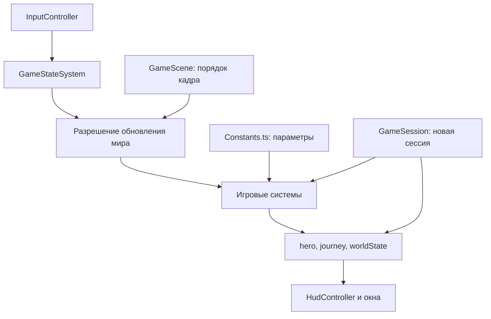

# Архитектура RAID COIN

Игра работает в одной сцене Phaser. Сцена создаёт состояния и системы, затем вызывает их в нужном порядке. Меню использует DOM поверх игрового холста. Для карты, паузы и отдельных кнопок не создаются сцены с копиями мира.

## Направление данных

Системы вызывают друг друга явно через типизированный контекст сцены. `import type` не загружает сцену во время выполнения. Общей шины событий нет. Разрешение импортов проверяется TypeScript при сборке.

## Владельцы состояния

| Данные                                      | Где хранятся                                         | Кто управляет                                                                  |
| ------------------------------------------- | ---------------------------------------------------- | ------------------------------------------------------------------------------ |
| Режим игры                                  | `GameStateSystem.current`, чтение через `flow.state` | `transitionTo()` проверяет переход; `reset()` начинает новую сессию            |
| HP, выносливость, движение и боевые окна    | `PlayerState`                                        | `PlayerController`, `CombatSystem`, `UltimateSystem` в пределах своих операций |
| Профиль, статистика, прогресс и задания     | `JourneyState`                                       | Экономика, задания и системы переходов; полный сброс запускает `GameSession`   |
| Появился ли босс                            | `journey.progress[i].spawned`                        | `BossAwakeningSystem`; загрузчик восстанавливает сохранённое значение          |
| Побеждён ли босс, выдана ли награда         | `progress[i].bossDead`, `rewarded`                   | `EnemyDefeatSystem`                                                            |
| Ярость конкретного босса                    | `Enemy.phase2`                                       | `BossSystem.updatePhase()`                                                     |
| Время и номер волны                         | Приватные поля `EnemySpawnSystem`                    | `updateWaves()` и `reset()`                                                    |
| Враги, монеты, снаряды, зоны и сундуки      | `WorldState`                                         | Система соответствующего вида объектов; общий сброс вызывает их очистку        |
| Вкладки, ввод, диалог и очередь уведомлений | `InterfaceState`                                     | Контроллеры интерфейса и владельцы конкретного окна                            |
| Спрайты, руки, слои и след оружия           | `RenderState`                                        | `SceneArtwork` и `ActorRenderer`                                               |
| Громкость и воспроизведение                 | `GameAudio`, `Soundtrack`                            | Аудиосистема; `AudioDirector` выбирает режим музыки                            |

`InterfaceState` не содержит копии режима игры. Видимость окна показывает уже принятое решение и не определяет, должна ли работать симуляция.

## Режимы и пауза

`ready`, `playing`, `paused`, `intro`, `story`, `dialog`, `shop`, `menu`, `map`, `loot`, `dying`, `won`, `confirm`, `travel` перечислены в `GameStateSystem`. Допустимые переходы находятся в таблице `GAME_TRANSITIONS` в `Constants.ts`.

Последовательность `playing → paused → menu → map → menu → paused → playing` сохраняет паузу при возвращении из вложенных окон. Переходы `won → paused` и `ready → shop` отклоняются. Новое путешествие и загрузка начинают отдельный жизненный цикл через `GameSession.reset()`.

Игровые часы обновляются только в `playing`: во время паузы не меняются интервалы волн, время биома, перезарядки, атаки и погода. Смена режима останавливает анимации мира в менеджере Phaser. Сюжет, похищение оружия, смерть, диалог и рулетка имеют отдельные обновления в своих режимах. Короткий toast использует таймер интерфейса; владелец отменяет его при сбросе и закрытии сцены.

## Пробуждение и ярость босса

В `BossAwakeningSystem.shouldAwakenBoss()` находится условие: герой в активном биоме, босс ещё не появился и не побеждён, сила биома достигла `REGIONS[index].coins`. Длительность пребывания в биоме не запускает босса. Поле `bossTime` оставлено в исторических данных областей.

`enterBossPhase()` выставляет `spawned` один раз и поручает `EnemySpawnSystem` создать босса, показать предупреждение и включить звук. Повторный вызов не создаёт второго босса.

`BossSystem.updatePhase()` проверяет долю HP из `BOSS_CONFIG.rageHealthRatio`, один раз устанавливает `Enemy.phase2` и призывает помощников. Условие появления босса и его боевая фаза разделены: изменение одного условия не требует переписывать другое.

## Один файл настроек

`Constants.ts` содержит общие неизменяемые определения: размеры мира, биомы, цели, параметры героя и противников, интервалы волн, атакующие окна, предметы, навыки, достижения, задания, тексты истории и обучения, настройки погоды, музыкальные темы, пути ресурсов, таблицы кадров и точки хвата.

В системах остаются алгоритмы: перемещение, проверка расстояния и направления, поиск пути, попадания, начисление наград, переходы и отображение. Локальная переменная `const distance` хранит результат расчёта и не является настройкой баланса. Геометрические команды процедурного рисунка остаются рядом с рисунком.

Время в настройках задаётся в секундах. Суффикс `Ms` обозначает миллисекунды. Расстояния заданы в координатах игрового мира. Проценты для полос интерфейса вычисляются при отображении.

| Изменение                  | Параметр                                              | Поведение                                             |
| -------------------------- | ----------------------------------------------------- | ----------------------------------------------------- |
| Максимальное здоровье      | `PLAYER_CONFIG`, `ATTRIBUTE_GAIN`                     | `CombatRules.stats()`                                 |
| Цена постоянного улучшения | `ATTRIBUTE_FIRST_PRICE`, `ATTRIBUTE_PRICE_STEP`       | `PlayerProgression.attributePrice()`                  |
| Число врагов и ритм волн   | `MAX_MINIONS`, `WAVE_SIZE`, `SPAWN_CONFIG`            | `EnemySpawnSystem.updateWaves()`                      |
| Характеристики врага       | `ENEMY_BASE_HP`, `ENEMY_PARAMETERS`, `REGIONS`        | `EnemyStats.enemyStats()`                             |
| Второй приём и навыки      | `HEAVY_ATTACKS`, `SKILL_ATTACKS`                      | `CombatRules`, `CombatSystem`                         |
| Абсолютная атака           | `ULTIMATE_CONFIG`, `ULTIMATE_MAX`                     | `UltimateSystem`; общую длительность читает отрисовка |
| Погода                     | `LIGHTNING_*`, `METEOR_*`, `HURRICANE_*`, `WEATHER_*` | `WeatherSystem`                                       |
| Музыка                     | `TRACKS`, `THEMES`, `DEFAULT_AUDIO`                   | `Soundtrack`, `AudioDirector`, `GameAudio`            |

## Сброс и ресурсы

`GameSession.reset()` очищает активные объекты и эффекты, сбрасывает генератор волн и погоду, освобождает ввод, затем сбрасывает данные героя, путешествия и интерфейса. Существующая ручная запись и доступность хранилища сохраняются: они относятся к браузеру, а не к новому путешествию.

`PlayerState.reset()` восстанавливает все объявленные поля, включая замедление, защиту, набор задетых целей и перезарядки навыков. `JourneyState.reset()` создаёт независимые записи прогресса и испытаний для каждого биома. `InterfaceState.resetSession()` сохраняет привязанные клавиши и контроллер отмены DOM-подписок, очищая данные путешествия.

Остановка сцены вызывает `InputController.destroy()`: отменяются обработчики DOM, мыши и клавиатуры. Система эффектов удаляет созданные частицы и подписи; аудиосистема останавливает записи и закрывает аудиоконтекст. Повторное создание сцены восстанавливает ссылки на новый мир. Общие текстуры используются повторно в пределах одного экземпляра Phaser.

## Папки и механики

| Путь                                | Ответственность                                                    |
| ----------------------------------- | ------------------------------------------------------------------ |
| `Constants.ts`                      | Общие параметры и таблицы                                          |
| `GameScene.ts`, `createGame.ts`     | Создание игры и порядок работы систем                              |
| `core/`                             | Режимы, сессия, прогресс путешествия, условие пробуждения          |
| `player/`                           | Движение, ресурсы, лечение, уклонение и входящий урон              |
| `combat/`                           | Обычные атаки, попадания, абсолютная атака, снаряды и опасные зоны |
| `enemies/`                          | Создание и движение врагов, волны, обычные приёмы, боссы и награды |
| `world/`                            | Границы, переходы, A\*, декорации и погода                         |
| `village/`                          | Дома, жители, разговоры и быстрые перемещения                      |
| `economy/`                          | Осколки, кошелёк, торговля и экипировка                            |
| `progression/`                      | Профиль, цены, покупка и сброс навыков, условия достижений         |
| `quests/`                           | Испытания, сюжетные поручения, сундуки, дневник и достижения       |
| `story/`                            | Сюжет, похищение оружия, уроки и указатели обучения                |
| `rendering/`, `rendering/textures/` | Позы, оружие, слои сцены, отдельные генераторы и нарезка атласов   |
| `audio/`                            | Воспроизведение, эффекты и выбор музыки                            |
| `persistence/`                      | Формат JSON, проверка, запись и загрузка                           |
| `ui/`                               | Ввод, HUD, меню, карты и временные данные окон                     |
| `scripts/`                          | Сборки и генерация справочника                                     |

## Крупные механики и имена файлов

| Механика             | Владелец поведения                                     | Отображение или правила                   |
| -------------------- | ------------------------------------------------------ | ----------------------------------------- |
| Снаряды              | `combat/ProjectileSystem.ts`                           | `rendering/WorldObjectRenderer.ts`        |
| Зоны урона           | `combat/HazardSystem.ts`                               | `rendering/WorldObjectRenderer.ts`        |
| Временные эффекты    | `rendering/CombatEffectRenderer.ts`                    | Владеет частицами и временем рисунков     |
| Поза и оружие героя  | Состояние в `PlayerState`                              | `rendering/HeroRenderer.ts`               |
| Вид врагов и жителей | Состояние мира                                         | `EnemyRenderer.ts`, `ResidentRenderer.ts` |
| Испытания            | `quests/QuestSystem.ts`                                | `quests/TrialRules.ts`                    |
| Сундуки              | `quests/LootSystem.ts`                                 | `quests/LootRollRules.ts`                 |
| Учебные враги        | `story/TutorialSystem.ts`, `persistence/SaveSystem.ts` | `story/TrainingEnemyRules.ts`             |
| Страницы карточек    | Соответствующий контроллер окна                        | `ui/Pagination.ts`                        |

Все численные настройки перечисленных механик находятся в `Constants.ts`. Формулы общих размеров и целей используются повторно; описания цен, вероятностей и целей формируются из тех же значений.

## Изменение требования

Найди правило через [HTML-карту](index.html). Для изменения числа или таблицы открой соответствующий раздел `Constants.ts`. Для изменения последовательности действий открой файл владельца механики. При добавлении временного поля определи, кто его обновляет и сбрасывает.

После правок выполни форматирование, обнови карту и запусти `verify`. Добавь запись в `CHANGELOG.md`. Новый модуль попадёт в карту автоматически; описание и карточку механики можно уточнить в `guide/catalog.json`.
